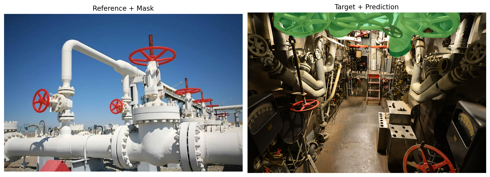

# INSID3 on realistic images: a prelabeling test

A hands-on test of [INSID3](https://github.com/visinf/INSID3) (training-free, one-shot in-context segmentation with DINOv3, CVPR 2026 Oral) on **complex, real-world images**, to see whether it can be used to **prelabel** data for a custom segmentation model.

> This repo is a fork-style clone of the official INSID3 code. All credit for the method goes to its authors; see [Credits](#credits). The original README is kept in [`UPSTREAM_README.md`](UPSTREAM_README.md).

- Video walkthrough (YouTube): _link to add_
- LinkedIn post: _link to add_

## The question

Given **one reference image with one mask**, can INSID3 find the same kind of object in a very different, cluttered target image, well enough to save annotation time?

## Example: industrial valve handwheels

| Reference + mask (made with SAM2) | Target + INSID3 prediction |
|---|---|
|  |  |

The reference is a clean outdoor pipeline. The target is a dense ship engine room with dark lighting, many pipes and many look-alike wheels. In this run INSID3 segmented the cream-coloured handwheels on the ceiling and **missed the red valves**. It is a failure case, and it shows the limits described below.

More files in [`examples/`](examples/): the reference image, the per-instance masks, the target and the predicted mask.

## Honest takeaways

- **INSID3 is not bulletproof.** It can miss objects, pick wrong ones (similar shape but a different thing, as above), and **the output changes from one inference to another**. Do not use it as an automatic labeler.
- **It is a good prelabeling tool when a human reviews the result.** Correcting a mask is much faster than drawing one from scratch, and you only need one annotated example to start.
- **It matters most when SAM3 can't help.** If SAM3 (text/concept prompts) does not have the domain knowledge to segment your object, INSID3 lets you define the object by example instead.

## The workflow

1. **Make one reference mask** with SAM2 from a click or two (`make_mask.py`).
2. **Run INSID3** on your unlabeled images with that reference (`run_minimal.py`).
3. **Review and correct** the masks in an annotation tool. `mask_to_coco.py` exports a mask as COCO 1.0 so you can import it into CVAT.
4. **Fine-tune a small model** on the corrected labels. It is cheaper and more stable at inference than running DINOv3 + INSID3 every time. The video explains this step in detail.

## Setup

The repo uses [uv](https://docs.astral.sh/uv/).

```bash
uv sync
SAM2_BUILD_CUDA=0 uv pip install "git+https://github.com/facebookresearch/sam2.git"
uv pip install opencv-python-headless   # needed by mask_to_coco.py polygon mode
```

Notes on what differs from upstream:

- **CRF refinement is disabled** in `pyproject.toml`, because it needs `nvcc` to build. Re-enable it if you have the CUDA toolkit.
- **Weights are not included.** Put the DINOv3 weights in `pretrain/` (see the [upstream instructions](UPSTREAM_README.md); DINOv3 is gated and has its own license) and the SAM2 checkpoint in `sam_ckpts/`. Both folders are gitignored. I only used the **small** and **base** DINOv3 models, so use `--model-size base`.
- **`uv sync` removes SAM2 and OpenCV**, since they are not INSID3 dependencies. Rerun the two install lines above afterwards.

## Usage

### 1. Make a reference mask (SAM2)

Click one point on the object (X,Y from any image viewer):

```bash
python make_mask.py examples/ref_valves.jpeg --points 320,240 --out ref_mask.png
```

Or click interactively (left click = foreground, right click = background, Enter = done):

```bash
python make_mask.py examples/ref_valves.jpeg --interactive --out ref_mask.png
```

Check the `*_overlay.png` it writes before using the mask.

### 2. Run INSID3

```bash
python run_minimal.py --ref examples/ref_valves.jpeg --ref-mask ref_mask.png \
    --target examples/my_target.jpg --out pred.png --model-size base
```

Run it with no arguments for the bundled cat demo.

### 3. Export a mask to CVAT (COCO 1.0)

```bash
# editable polygons (default)
python mask_to_coco.py pred_mask.png --image examples/my_target.jpg --out ann.json --label object

# pixel-perfect mask (keeps holes and detail)
python mask_to_coco.py pred_mask.png --image examples/my_target.jpg --out ann.json --label object --seg-format rle
```

In CVAT: **Actions → Upload annotations → COCO 1.0**, on a task containing the same image. `--label` must match a label in the task.

## What I added to the upstream repo

| File | Purpose |
|---|---|
| `make_mask.py` | Reference mask generation with SAM2 (points or interactive) |
| `run_minimal.py` | Minimal INSID3 inference on your own image and mask |
| `mask_to_coco.py` | Binary mask to COCO 1.0 JSON for CVAT |
| `examples/` | Images from the test (all sourced from the internet) |
| `pyproject.toml`, `uv.lock` | CRF dependency disabled, reproducible environment |

## Credits

INSID3 is by Claudia Cuttano, Gabriele Trivigno, Christoph Reich, Daniel Cremers, Carlo Masone and Stefan Roth. Paper: [arXiv:2603.28480](https://arxiv.org/abs/2603.28480) · [Project page](https://visinf.github.io/INSID3/) · [Original code](https://github.com/visinf/INSID3). Please cite their work, not this repo, if you use the method. Code is under the Apache-2.0 license (see `LICENSE`).

The example images come from the internet and belong to their respective owners. They are included for illustration only.
